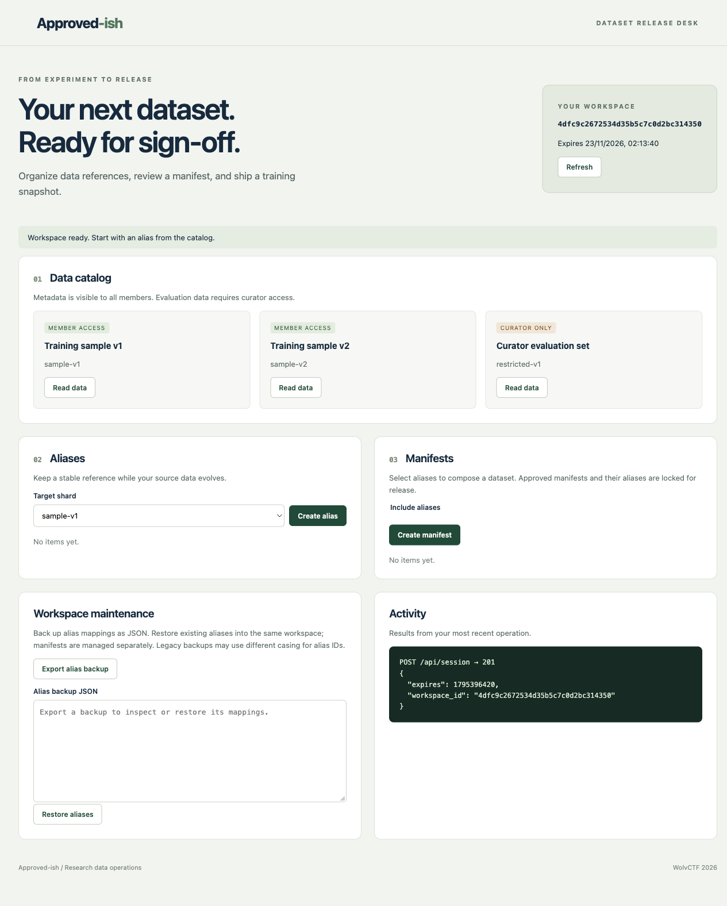
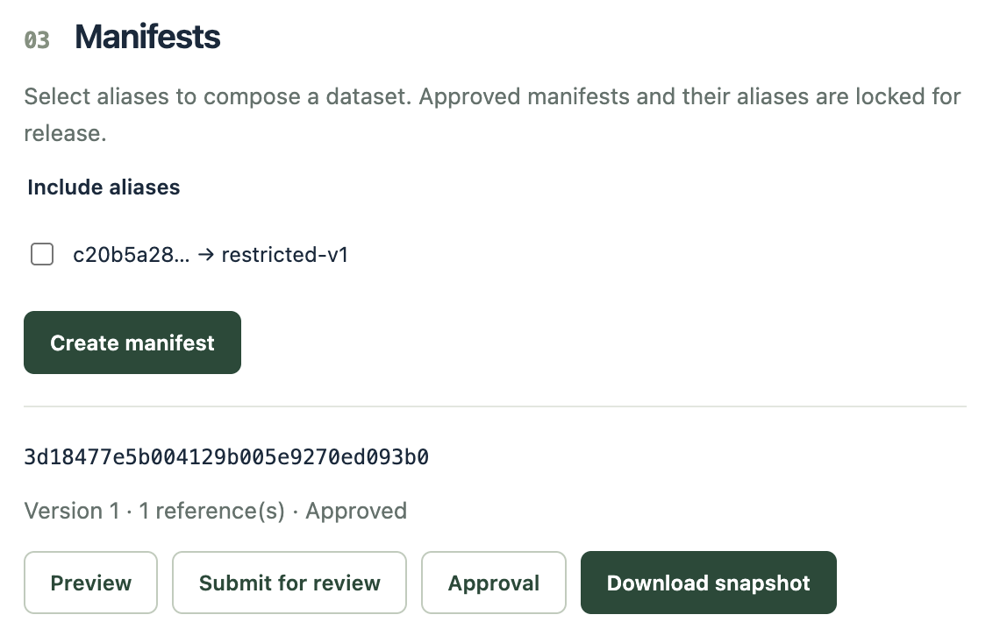
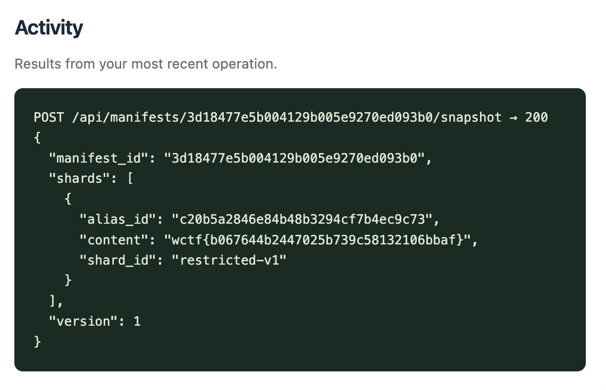

## Recon

Approved-ish is a dataset "release desk" with a review workflow. You create
*aliases*, each pointing at a *shard*; you group aliases into a *manifest*; and
only a manifest that has been reviewed and approved can be exported as a snapshot.
The goal is the flagged shard `restricted-v1`, which members are not allowed to read.



The weakness is in the timing of the checks. The reviewer verifies a manifest's
aliases *at review time*, but the snapshot is built later, *at export time*, and it
resolves each alias to its *current* target. If we can get an approval for a
manifest that points at a harmless shard, then change one alias's target to
`restricted-v1` before exporting, the snapshot will contain the restricted shard
even though the reviewer never saw it.

One thing stands in the way: approving a manifest *locks* its aliases, so the
target can't simply be edited afterward. The client interface also exposes an
alias backup/restore feature, a separate write path that the normal edit path
does not guard the same way.

## Changing a locked alias

We go through the legitimate flow first to earn a clean approval: create an alias
pointing at the public `sample-v1` shard, put it in a manifest, and submit the
manifest for review.



The manifest is approved and the alias is locked; changing its target to
`restricted-v1` is rejected. So we use the backup/restore feature as a second way
in. We export the aliases as JSON, edit the copy offline, and import it back. We keep
the alias's ID but uppercase it (`c3a48cbbc8c44771a279d2bedf767fb2` becomes
`C3A48CBBC8C44771A279D2BEDF767FB2`) and set the target to `restricted-v1`:

```json
{"aliases":[{"id":"C3A48CBBC8C44771A279D2BEDF767FB2","target_shard_id":"restricted-v1"}],"format":"approved-ish.aliases.v1","workspace_id":"10cddb94f76d497cb8f225b975a4e5db"}
```

This works because the server handles casing inconsistently. The lock check
compares the alias ID *case-sensitively*, so the uppercase ID does not match the
locked lowercase record and the edit is allowed through. The restore's lookup that
resolves the alias, however, is *case-insensitive*, so it lands on the original
lowercase alias and updates its target. The alias ends up still marked
`locked: true`, but pointing at `restricted-v1`.

## Flag capture

Exporting a snapshot of the approved manifest now resolves the mutated alias to
`restricted-v1`, so the snapshot contains the flag under cover of an approval the
reviewer gave to a harmless manifest.



```text
wctf{b067644b2447025b739c58132106bbaf}
```