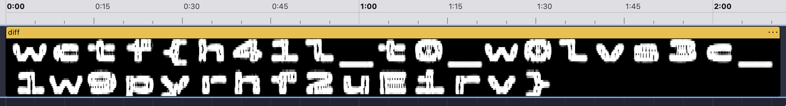

## Recon

The challenge supplies `wav1.wav` and `wav2.wav`. Both are 16-bit mono PCM (raw sampled audio) at 44,100 Hz, contain 5,798,064 samples, and sound identical. Combining the two signals should reveal more than analyzing either one alone.

Active noise cancellation removes a signal by adding its inverse. Here, subtracting corresponding samples cancels the loud carrier shared by the files and leaves the component in which they differ. We widen the samples to 32 bits before subtracting. Peak-normalization rescales the residual to the loudest sample, and we then write the result to a new WAV file.

```python
import wave
import numpy as np


def read_wav(path):
    with wave.open(path, "rb") as wav:
        params = wav.getparams()
        samples = np.frombuffer(wav.readframes(wav.getnframes()), dtype=np.int16)
    return params, samples


params, first = read_wav("wav1.wav")
_, second = read_wav("wav2.wav")
assert len(first) == len(second)

residual = first.astype(np.int32) - second.astype(np.int32)
residual = residual * (32767 / np.max(np.abs(residual)))

with wave.open("diff.wav", "wb") as output:
    output.setparams(params)
    output.writeframes(residual.astype(np.int16).tobytes())
```

The difference is mostly inaudible, and its strongest feature is subsonic, around 17 Hz. A full-band spectrogram leaves the low-frequency text compressed into a few pixels while brighter audio features dominate the color scale. Restricting the display to low frequencies and switching to a Mel scale exposes the message.

## Flag capture

We open `diff.wav` in Audacity, switch to spectrogram view, and use:

- **Mel** scale with a maximum frequency of **100 Hz**;
- window size **32768**, rectangular window, and zero-padding factor **2**;
- gain **20 dB**, range **5 dB**, and no high-frequency boost;
- **Frequencies** algorithm and **inverse grayscale** colors.

The Mel scale allocates more vertical resolution to low frequencies, while the narrow amplitude range makes the letter strokes stand out. With these settings, the low-frequency tones form a readable two-line raster.



Reading the two spectrogram lines gives the flag:

```text
wctf{h41l_t0_w0lvs3c_1w9pyrhf2uEirv}
```
