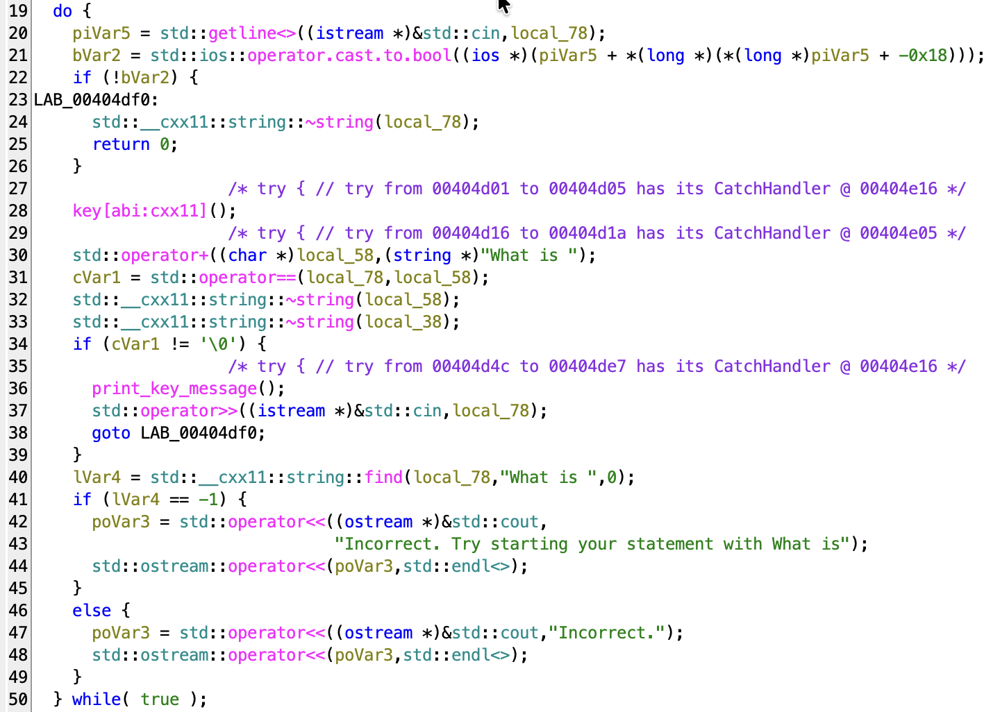
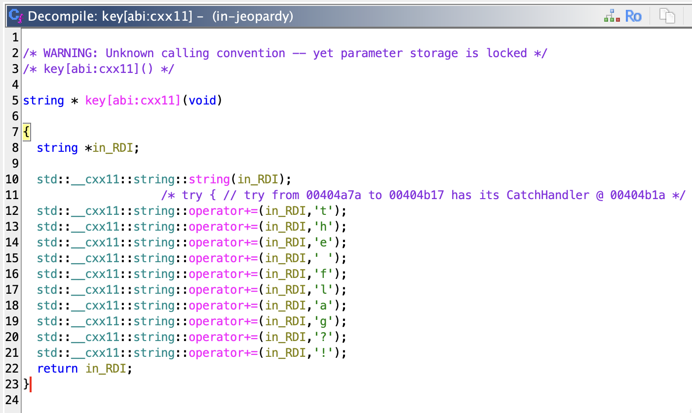

## Recon

The handout is a single Linux binary. After extracting it, the first thing we do is run the executable. It presents the Jeopardy prompt and waits for an answer, so we try `the flag`:

```bash
$ tar -xzf dis.tar.gz
$ ./in-jeopardy
the flag
Incorrect. Try starting your statement with What is
```

The rejection tells us to respond in the form of a question, but we still need the exact expected wording. Static analysis starts by identifying the binary:

```bash
$ file in-jeopardy
in-jeopardy: ELF 64-bit LSB executable, x86-64, version 1 (GNU/Linux),
statically linked, with debug_info, not stripped
```

The preserved C++ symbols and DWARF debug info make static analysis straightforward. We load the binary into Ghidra and use objdump alongside the decompilation.

`main` reads full lines with `std::getline(std::cin, input)` and compares each line with `"What is " + key()`. A match calls `print_key_message()`; any other input prints the hint seen during the first run.



## Exploitation

### The expected answer

`key()` constructs its return value one character at a time through repeated calls to `std::string::operator+=`. Each call receives a single immediate in `%esi`, keeping the complete answer out of the `strings` output. Pulling the immediates out of the objdump listing spells the answer directly:

```asm
404a72:  be 74 00 00 00   mov  $0x74, %esi      # 't'
404a83:  be 68 00 00 00   mov  $0x68, %esi      # 'h'
404a94:  be 65 00 00 00   mov  $0x65, %esi      # 'e'
404aa5:  be 20 00 00 00   mov  $0x20, %esi      # ' '
404ab6:  be 66 00 00 00   mov  $0x66, %esi      # 'f'
404ac7:  be 6c 00 00 00   mov  $0x6c, %esi      # 'l'
404ad8:  be 61 00 00 00   mov  $0x61, %esi      # 'a'
404ae9:  be 67 00 00 00   mov  $0x67, %esi      # 'g'
404afa:  be 3f 00 00 00   mov  $0x3f, %esi      # '?'
404b0b:  be 21 00 00 00   mov  $0x21, %esi      # '!'
```

That spells `the flag?!`, so the response the program wants is **`What is the flag?!`**.

### The flag decoder

`print_key_message()` runs only after a correct answer:



It constructs a `std::string` from a C string literal at address `0x55a008`, then iterates over every character and appends `(char)(c - 3)`. The `subl $0x3, %eax` in the loop body implements the entire decoder:

```asm
404bdd:  movzbl -0x19(%rbp), %eax
404be1:  sub  $0x3, %eax          # decode: c - 3
404be4:  movsbl %al, %edx
404bf0:  call <std::string::operator+=(char)>
```

To recover the flag, we need to apply that shift to every byte of the literal. Dumping the raw bytes with radare2 reveals an important detail:

```
0x0055a008  7a66 7769 7e46 6b37 3434 4871 6a36 3830   zfwi~Fk744Hqj680
0x0055a018  6933 5562 775a 3330 4b58 5147 5536 4780   i3UbwZ30KXQGU6G.
0x0055a028  0000 436f 7272 6563 7421 2000             ..Correct! .
```

The encoded string is 32 bytes, and its final non-printable byte `0x80` is omitted by `strings` and radare2's `ps`; subtracting 3 gives `0x7d`, the closing `}`. Decoding all 32 bytes with `c - 3`, including that final byte, therefore recovers the complete flag.

## Flag capture

Running the binary on a Linux machine and answering with the recovered question confirms the static reconstruction:

```bash
$ ./in-jeopardy
> What is the flag?!
Correct!
wctf{Ch411Eng35-f0R_tW0-HUNDR3D}
```
