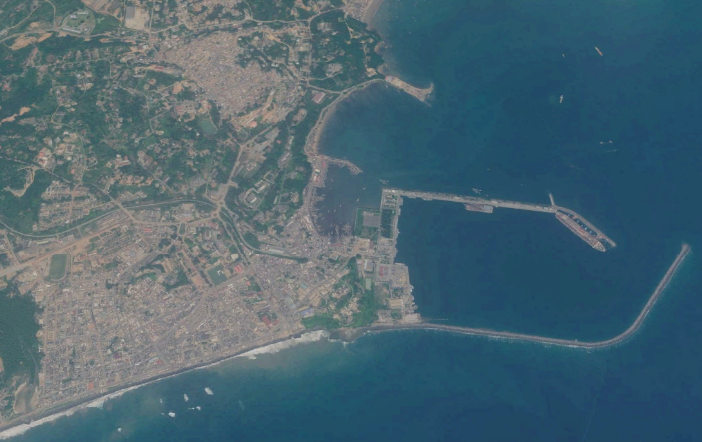

The challenge is a single satellite screenshot of an African coastal port.



## Recon

The clues decompose cleanly. "The world's second largest continent" pins the
location to **Africa**. "The big one" warns that a second, smaller vessel in the
same harbor is a distractor. "At least 5 years" tells us the target is a
*permanently moored* ship, one we expected to find through historical imagery
since a vessel that sits still for years falls out of the usual vessel-tracking
feeds. The file has no useful metadata, so everything comes from the pixels.

We uploaded the screenshot to Google Gemini and asked it to reverse-search the
image and identify the port and the large, permanently moored ship, explaining
that it had sat still for at least five years. Gemini returned
**Sekondi-Takoradi, Ghana** and the vessel **MV Karadeniz Powership Osman
Khan**, whose IMO (International Maritime Organization ship identification
number) is **9189158**.

We verified both against Esri's **Wayback Imagery**, which shows the same large
vessel at the same berth across years of historical captures, and against the
VesselFinder record for the Osman Khan (IMO 9189158). The Osman Khan was built
in 2000 as the bulk carrier **MV Pacific Triangle**, later converted into a 470
MW floating power plant, and
relocated from Tema to Sekondi-Takoradi in August 2019. It has remained
stationary there since, comfortably exceeding the five-year residency clue;
the ship's earlier name also explains the title's reference to its origins.

## Flag capture

The ship's seven-digit IMO number, which passes the standard IMO check-digit
sum (weights 7–2 from the right of the first six digits give 158 mod 10 = 8,
the check digit), is the flag:

```text
wctf{9189158}
```
