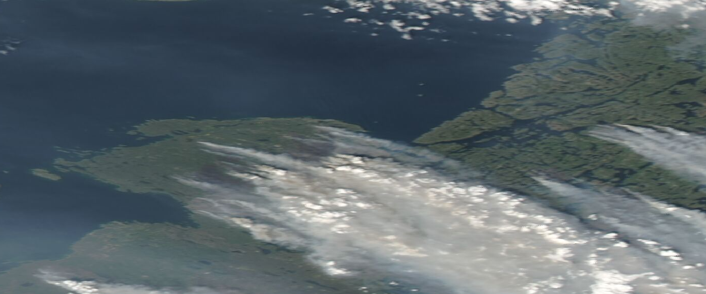

The handout is a single, metadata-free PNG screenshot (1431×597) and one
question: what body of water is this? The answer goes in the flag in lowercase
with spaces as dashes.



## Recon

The image shows a vast dark basin opening to the upper left, a landmass on the
right split by long straight channels, a rounded peninsula-rich island at
center-left, and broad translucent gray-brown plumes lying across land and
water like smoke. What stands out most is the coastline: where ordinary shores
are smooth, this one is shattered into a maze of small islands and narrow,
drowned channels. The plumes were the visual hook. The title "Pants On Fire"
("liar, liar") points at fire and smoke, so the scene is a body of water with
wildfire smoke drifting over it.

Map matching did not help. Comparing the coastline against conventional maps
led us to Katmai and the Shelikof Strait, and automated matching over a dozen
candidate lakes and seas only produced false positives.

Rather than keep guessing at coastlines, we uploaded the screenshot to Google
Gemini and asked it to reverse-search the image and name the body of water,
describing what we could see: a large lake, wildfire smoke, and a shore broken
into dozens of small islands. Gemini identified **Great Bear Lake**, Northwest
Territories, Canada, and pointed us at the source coverage of the **July 2026
wildfires** along its shore ([CIRA's "Wildfires Pockmark Around Great Bear
Lake"](https://satlib.cira.colostate.edu/weather_media/wildfires-pockmark-around-great-bear-lake)).

The source also explains why our maps never matched: it is a **geostationary
weather-satellite view (GOES-18/GOES-West class)**, not a nadir map. A GOES
platform sits about 35,786 km over the equator, so a target near 66°N appears
at a grazing oblique angle that distorts the coastline.

## Flag capture

```text
wctf{great-bear-lake}
```
