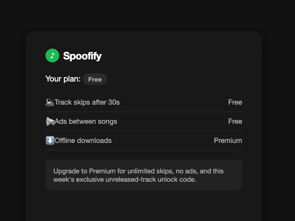
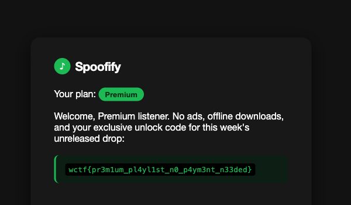

Spoofify advertises Free and Premium listening plans, and this week's unreleased-track unlock code is reserved for Premium. There is no login flow, so the plan tier has to live somewhere the browser sends back on every request.



## Cookie tampering

The homepage's response reveals how the plan is stored: the very first visit sets a cookie.

```text
set-cookie: sid=free; Path=/
```

We open the browser's developer tools, go to the cookies panel, and find the `sid` cookie with the value `free`. There is no signature or encoding protecting it, so we edit the value to `premium`, reload the page, and the server now renders the Premium view.



## Flag capture

The Premium page includes this week's unlock code, which is the flag:

```text
wctf{pr3m1um_pl4yl1st_n0_p4ym3nt_n33ded}
```
