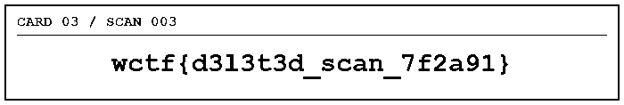

## Recon

The handout extracts to `card.img`, and `file` identifies it immediately as a
classic 1.44 MB floppy geometry image formatted as FAT12, the 12-bit File
Allocation Table filesystem used by floppies.

```bash
$ tar -xzf dis.tar.gz
$ file card.img
card.img: DOS/MBR boot sector, OEM-ID "MSDOS5.0", sectors/cluster 4,
root entries 224, sectors 2880, FAT (12 bit), serial number 0x20260003,
label: "CARD03     "
```

From the boot-sector parameters we derive the layout precisely: sector 0 is the
boot sector, sectors 1–18 hold the two 9-sector FATs, sectors 19–32 hold the
root directory, and the data area starts at sector 33 with 4 sectors per
cluster. A scan of the raw image shows it is almost entirely zeroed. Only the
boot sector, the root directory sector, and a couple of data sectors contain
anything.

Someone had wiped both FAT copies but never touched the actual file
content, so a normal FAT "delete" (which only marks the directory entry with
`0xE5` and frees the cluster chain) was recoverable once we found where the data
lived without the FAT.

Reading the root directory sector (offset 19 × 512 = `0x2600`) reveals a single
32-byte entry:

```bash
$ xxd -s $((19*512)) -l 32 card.img
00002600: e543 414e 3030 3033 504e 4720 0000 0000  .CAN0003PNG ....
00002610: 0000 0000 0000 0000 0000 0200 fc03 0000  ................
```

The first byte `0xE5` is the classic deletion marker, the remainder
spells the 8.3 name `CAN0003.PNG`, the little-endian bytes at offset 26 hold the
start cluster `02 00` = **2**, and the size `fc 03 00 00` = **1020 bytes**. FAT
places cluster 2 at the very start of the data area, so its byte offset is a
fixed `33 × 512 = 16896`. With the offset and length known, we could carve the
file directly and verify its PNG chunk CRCs.

## Flag capture

```bash
$ dd if=card.img of=can0003.png bs=1 skip=16896 count=1020
$ file can0003.png
can0003.png: PNG image data, 700 x 118, 1-bit grayscale, non-interlaced
```

Successful validation of every PNG chunk and CRC confirms that the file was
contiguous; the wiped FAT cannot tell us that.



```text
wctf{d3l3t3d_scan_7f2a91}
```
