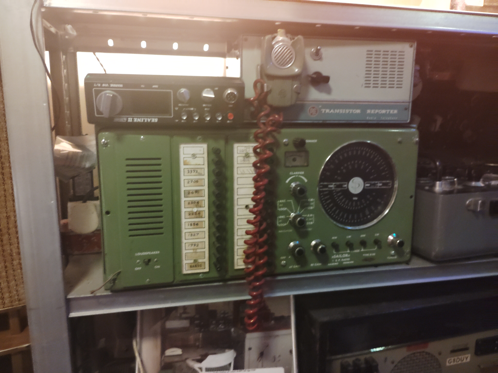

The challenge is a single photograph of a small museum room packed with vintage radio equipment.



## Recon

The description's phrase "a series of defensive forts" is a textbook reference
to the **Martello towers**, the small round coastal forts the British built
across their empire during the Napoleonic Wars (dozens dot the Irish and
English coastlines, many now repurposed as little museums).

The photo shows a cramped, warm-lit interior with metal shelves of vintage
*marine* radio gear: a distinctive green **SAILOR** receiver (S.P. Radio,
Denmark) with handwritten MF/HF frequency labels on its faceplate, a **"SEA
LINE II"** transceiver, and a UK amateur callsign sticker **G3OUY** in the
corner. The circular stone tower, packed shelves, and maritime radio sets
suggested a privately curated vintage-radio collection.

We tried reverse image search alongside targeted searches combining "Martello
tower" and "vintage radio museum". Those searches led to **Ye Olde Hurdy Gurdy
Museum of Vintage Radio**, housed in the Martello Tower overlooking Howth
Harbour, County Dublin, Ireland. [The museum's own
site](https://sites.google.com/site/hurdygurdymuseum/home) names **Pat Herbert**
as "the founder and curator" of the museum.

## Flag capture

```text
wctf{Pat_Herbert}
```
